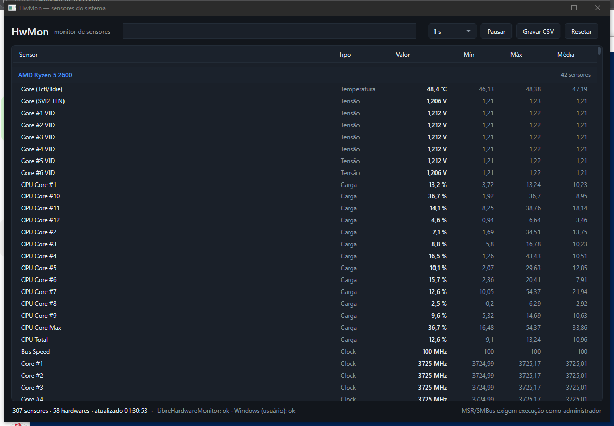

# HwMon

Monitor de sensores para Windows — um **clone funcional** do monitoramento do HWiNFO64,
escrito em C#/.NET sobre APIs e bibliotecas abertas.

Não usa código, drivers ou recursos do HWiNFO. A engenharia reversa do original serviu só
para mapear a arquitetura e decidir o que valia a pena reimplementar (dossiê em
`E:\Projetos\hwinfo-clone\docs\01-arquitetura.md`).



```
┌──────────────────────────┐
│  HwMonitor.App (WPF)     │  tabela agrupada, filtro, alertas, CSV
├──────────────────────────┤
│  HwMonitor.Core          │  SensorHub, provedores, estatísticas, alertas, CSV
│   ├─ LibreHardwareMonitor│  CPU/GPU/placa-mãe/RAM/discos/rede (MPL-2.0)
│   └─ SystemPerformance   │  APIs de usuário do Windows (sem driver)
├──────────────────────────┤
│  HwMonitor.Cli (hwmon)   │  list / watch / export / providers
└──────────────────────────┘
```

## Estado atual (validado nesta máquina)

| Item | Resultado |
|---|---|
| Sensores coletados | **307** em **58** hardwares (como admin); **263** sem privilégios |
| CPU | AMD Ryzen 5 2600 — ~48 °C (Tctl/Tdie), 3725 MHz, ~24 W, VIDs por núcleo |
| GPU | NVIDIA GeForce RTX 2060 — 39 °C core, 56 °C hotspot, 1005 RPM |
| Placa-mãe | ASUS PRIME A320M-K/BR + ITE IT8655E (ventoinhas e tensões) |
| Armazenamento | SMART/NVMe (SSD 128 GB, Gomos GT400) |
| Memória / rede / discos | uso, throughput, espaço livre |
| App WPF | tabela agrupada por hardware, filtro, pausa, log CSV, alertas |

## Requisitos

- Windows 10/11 x64
- .NET SDK 10 (ou runtime 10 para rodar um build publicado)
- **Administrador** para os sensores de MSR/SMBus (temperatura, tensão e potência da CPU,
  ventoinhas e tensões da placa-mãe)

## Compilar e rodar

```powershell
$env:PATH = 'E:\tools\dotnet;' + $env:PATH
cd E:\Projetos\hwmon
dotnet build

# CLI
.\src\HwMonitor.Cli\bin\Debug\net10.0-windows\hwmon.exe list

# App
.\src\HwMonitor.App\bin\Debug\net10.0-windows\HwMon.exe
```

Para os sensores completos, abra o terminal (ou o atalho do app) **como administrador**.

> O apphost do .NET procura o runtime em `DOTNET_ROOT`. Nesta máquina ele já está definido
> como `E:\tools\dotnet` (variável de usuário).

### Build publicado

Já existe um build Release em `dist\`:

```text
dist\app\HwMon.exe     # app WPF
dist\cli\hwmon.exe     # CLI
```

Para regenerar:

```powershell
dotnet publish src\HwMonitor.App\HwMonitor.App.csproj -c Release -r win-x64 --self-contained false -o dist\app
dotnet publish src\HwMonitor.Cli\HwMonitor.Cli.csproj -c Release -r win-x64 --self-contained false -o dist\cli
```

Clique com o botão direito em `HwMon.exe` → **Executar como administrador** para liberar
temperatura/tensão/potência da CPU e os sensores da placa-mãe.

## CLI

```text
hwmon list                       # uma amostra de todos os sensores
hwmon watch --interval 1000      # atualiza a tela (Ctrl+C para sair)
hwmon export --duration 60 --csv sensores.csv
hwmon providers                  # estado de cada provedor
```

Opções: `--interval <ms>`, `--duration <s>`, `--csv <arquivo>`, `-h`.

## App WPF

- Tabela agrupada por hardware, com nome do sensor, tipo, valor atual, mín/máx/média da sessão.
- Filtro por sensor ou hardware; intervalo de 0,5 s a 5 s; pausar; resetar estatísticas.
- Linhas em alerta ficam destacadas em vermelho e a barra superior mostra a mensagem.
- `Gravar CSV` escreve em `Documentos\HwMon\hwmon-<data>.csv`.
- A leitura de hardware roda em thread de fundo, então a janela não congela entre amostras.

### Alertas

Regras padrão em `HwMonitor.Core/Alerts/AlertRule.cs`:

```csharp
new AlertRule(string.Empty, Comparison.Above, 90, "Temperatura acima de 90 °C", SensorKind.Temperature)
```

`AlertRule` aceita um padrão de texto (`SensorPattern`, vazio = qualquer) e um filtro por
tipo (`SensorKind`). Para vigiar ventoinha parada ou carga alta:

```csharp
new AlertRule(string.Empty, Comparison.Below, 300, "Ventoinha parada", SensorKind.Fan),
new AlertRule(string.Empty, Comparison.Above, 95, "Carga acima de 95%", SensorKind.Load),
```

O avaliador emite só transições (disparou/normalizou), então a UI não é inundada a cada
amostra.

## CSV

Uma linha por sensor por amostra:

```text
timestamp,sensor_id,hardware,sensor,kind,value,unit,min,max,avg
2026-10-27T01:23:10-03:00,lhm/amdcpu/0/load/2/CPU Core #1,AMD Ryzen 5 2600,CPU Core #1,Load,11.6081,%,11.6081,11.6081,11.6081
```

## Por que LibreHardwareMonitor 0.9.3

A versão está fixada em **0.9.3** de propósito: é a última que ainda carrega o driver de
kernel (WinRing0) embutido. A partir da 0.9.4 a biblioteca deixou de trazer o driver e, sem
ele, os sensores de MSR da CPU retornam 0 no Windows.

Medido nesta máquina (Ryzen 5 2600):

| Versão | Tudo de CPU |
|---|---|
| 0.9.6 | 0,0 °C (driver ausente) |
| **0.9.3** | **46,9 °C**, 3725 MHz, 22 W |

### Aviso de segurança

O WinRing0 dá acesso a portas de I/O e MSRs, e está na lista de drivers vulneráveis da
Microsoft. Em algumas máquinas/Windows ele pode ser bloqueado (Code Integrity, HVCI ou
antivírus) e aí os sensores de CPU voltam a faltar. Isso é inerente ao acesso de ring 0 —
o próprio HWiNFO resolve com um driver assinado próprio, que este projeto **não** replica.

## O que o clone cobre e o que não cobre

Coberto:

- CPU: temperatura, tensão, clock, potência, carga por núcleo
- GPU: temperatura (core/hotspot/memória), ventoinha, tensão, clocks, carga
- Placa-mãe: ventoinhas e tensões via SMBus/EC (quando o chip é suportado)
- Memória: uso, disponível, total
- Discos: SMART/NVMe, espaço, atividade
- Rede: throughput por interface
- Sistema: tempo ligado

Não coberto (exigiria engenharia reversa de driver ou SDKs de terceiros):

- SPD/DIMM por módulo (fabricante, timings, XMP)
- Sensores internos de VRM e limites de CPU por modelo
- Periféricos proprietários (AIOs, PSUs, controladores Corsair/NZXT)
- OSD em jogos, benchmark embutido, relatórios HTML
- Driver de kernel próprio

## Estrutura

```text
hwmon/
├─ Directory.Build.props
├─ HwMon.slnx
├─ docs/
│  └─ ui.png                    # screenshot do app
├─ src/
│  ├─ HwMonitor.Core/           # biblioteca (net10.0-windows)
│  │  ├─ Alerts/                # AlertRule + AlertEvaluator
│  │  ├─ Logging/               # CsvLogger
│  │  ├─ Providers/             # LibreHardwareMonitor + SystemPerformance
│  │  └─ Sensors/               # SensorKind, SensorReading, SensorHub
│  ├─ HwMonitor.Cli/            # hwmon.exe
│  └─ HwMonitor.App/            # HwMon.exe (WPF)
└─ tools/
   └─ fix-encoding.mjs          # reparo de mojibake em fontes
```

## Licença

- Código deste projeto: MIT.
- `LibreHardwareMonitorLib` (dependência): **MPL-2.0**.
- `HWiNFO` é marca de REALiX s.r.o.; este projeto não é afiliado nem redistribui nada dele.
